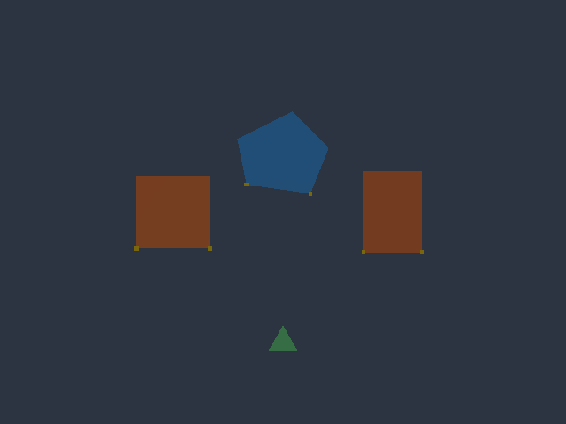

# Completed individual functional checks

Refs #79 and #80. All issues and milestones remain open.
This archive accepts no whole product or milestone.
The full 26,880-record multi-data matrix is still running.
The remaining retained corpora and assets are also incomplete.

The effective Rust implementation is still
`0a5a3bed31b974fc5cee98155c3dc7113bf12a87` on the multi-data core.
These checks used the frozen source tree at
`bd13f3d424f2649b4b25c16305c4e5b0eb7f8542`.
No product, test, tool or frozen contract changed during the long runs.
The new files in this change only preserve completed evidence.

The default executable SHA-256 is
`64ac734c68a8860d5b65e5694c7ea81bb4df7d5db922a0c07f876bcccd1c8019`.
The preview executable SHA-256 is
`518d5cb60791ccbd40c972e875807d836120aceadb4183c95e0647147bc00b65`.

## Completed retained interfaces

- All 2,048 single-data merge records passed. The actual parent waited for
  PID 24775 and recorded exit 0. A separate audit checked every raw request,
  result, source comparison, receipt and saved/fresh scene. Its PID 99183
  exited 0. Eleven full-gate corruption controls passed. Eleven additional
  receipt/transport corruption controls also passed. These are separate
  control sets. Neither set executes forged operations.
- All 3,584 delta records passed. The child PID 19811 exited 0. A separate
  audit rechecked all raw records against both source runs. All 3,584 records
  kept their defined numeric classification. Its PID 4582 exited 0.
- The adapted audit scripts change only actual worktree, output, executable
  and source-head bindings. Each binding file records both hashes and the exact
  diff. Reversing the declared replacements recovers the original script.
  Original assertions, counts, limits and source comparisons stay unchanged.

These are 5,632 completed retained interface records. The other 10,742
retained interface records and all 1,687 asset checks still need completion.
The running retained parent has no whole-run acceptance yet.

## Frozen controls with source and answer reads denied

The eight frozen multi-data Rust tests and nine retained history/UV tests were
compiled against the actual release library. macOS denied product reads from
both repositories, the source worktree and prior runtime answer folders.
Four real cat controls proved the denials. The eight-test process PID 78017
and nine-test process PID 78145 both exited 0 with zero ignored tests.

The first parent failed in its final path-hash helper. It did not save child
terminal receipts. That attempt is not accepted. Its binaries, output and
diagnostic remain in `native-first-diagnostic/`. The corrected parent uses the
same binaries and frozen inputs. It records each child start and terminal
result immediately. Its evidence is in `native-denied/`.

## New two-data save failure and provider checks

`unseen-failed-save/` uses new literal geometry and simple exact affine frames.
It has two independent edited meshes, a linked non-provider and outside data.
The active alias and the second provider have distinct frames.
The actual Rust process completed 27 native protocol calls.

CURSOR results match the independent analytic local points. Both actual
provider world points equal the cursor. The linked non-provider has the
correct different world point. Shared identity and scale locks stay intact.

Stale revision, aggregate budget, unknown input and a known late batch command
all reject without file or scene changes. Replacing only this test's scene
file with an empty directory causes the real `Is a directory (os error 21)`
save error. Both assets, revision and empty undo history stay intact.
The empty directory is retained under a new name. The original scene file is
restored. The valid operation, undo, replay and fresh process load then pass.
All source and prior-answer reads remain denied. No test artifact is deleted.

## Metal output and visual check

`metal/` contains actual renders on `Apple M1 Max (Metal, IntegratedGpu)`.
Both independent meshes and the linked user change after the context merge.
Both UV layers retain their expected loops. The outside green mesh is exact.
Scene, queries, state and PNG bytes are identical after a separate fresh load.
The before/after images have 8,478 changed pixels. The original minimum stays
500 pixels. No performance claim is derived from this render.

Both PNGs were visually inspected. Two linked orange quads become triangles.
The independent blue pentagon becomes a quad. Yellow selection marks follow
the survivors. The outside green triangle stays unchanged.

## Recipe and regeneration checks

The retained single-data recipe driver passes 20 cases and 120 atomic failure
controls. Its old assertions are unchanged. Bindings and raw results are kept.

The new multi-data recipe driver tests five methods, two UV settings and two
interfaces. The interfaces are the real native CLI server and official MCP.
It passes all 20 cases and 120 atomic failure controls. Two generated cubes
have different parameters and one linked user. Both recipe flags stay false
after empty-selection skips. Processed assets become edited. FIRST/LAST leave
the later data byte-equivalent. Regeneration restores each original recipe
and geometry. Undo, replay, context, sharing and fresh loads all pass.

A separate audit binds all 600 raw calls and all 20 actual terminal receipts.
It checks independent analytic merged points, detailed/aggregate receipts,
recipe flags, every queried scene, regeneration and fresh load. Six forged
recipe/transport records are rejected. Original raw files remain unchanged.

## Archive and pending gates

`completed-functional-01/archive-manifest.json` binds 5,976 lossless source
copies. It records raw and stored hashes. Original files and failed attempts
remain outside this checkout. PNG and Python files stay directly viewable.
Other large raw files can use lossless gzip. Empty source directories remain
preserved and are listed separately.

The 26,880-record matrix, its complete raw audit, the remaining retained
interfaces/assets, all 207 retained timing/source samples and other required
native checks still need completion. Timing checks must keep their original
workloads and clocks. Three-platform CI, dependency integration and independent
Codex acceptance also remain required. The prior exact-head CI jobs could not
start due to the account payment/spending restriction. No unrun gate passes.
